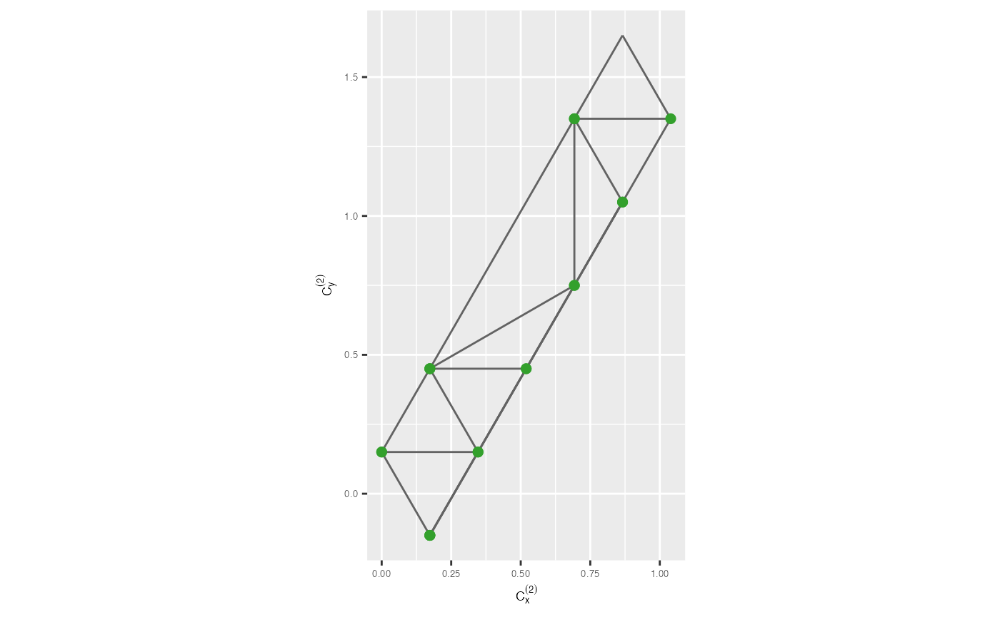
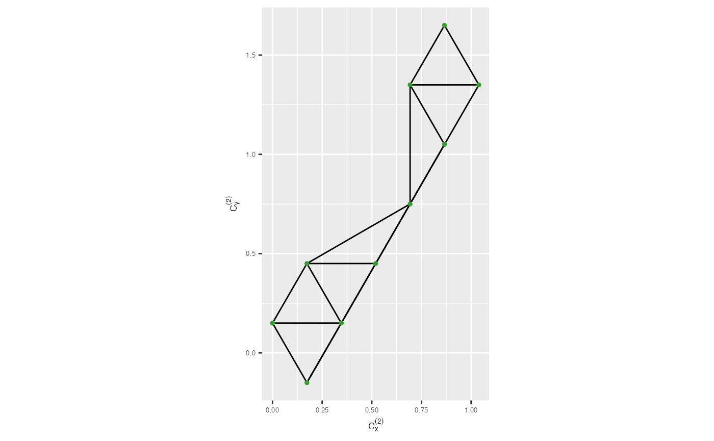

# 1. Main steps

## Constructing the model in the 2D space

### 1. Compute hexagonal grid configurations

#### Number of bins along the x-axis

To begin the algorithm, you need to determine the number of bins along
the x-axis for creating regular hexagons in the hexagonal grid.

``` r

num_bins_x <- calculate_effective_x_bins(nldr_df = s_curve_noise_umap_scaled,
                                         x = "UMAP1", hex_size = 0.2)
num_bins_x 
#> [1] 5
```

#### Number of bins along the y-axis

Then, you need to determine the shape parameter, which control the shape
and size of the hexagons in the hexagonal grid.

``` r

num_bins_y <- calculate_effective_y_bins(nldr_df = s_curve_noise_umap_scaled,
                                         y = "UMAP2", hex_size = 0.2)
num_bins_y 
#> [1] 8
```

### 2. Obtain hexagonal bin centroids

``` r

hb_obj <- generate_hex_binning_info(nldr_df = s_curve_noise_umap_scaled,
                            x = "UMAP1", y = "UMAP2", num_bins_x = num_bins_x,
                            num_bins_y = num_bins_y, x_start = NA,
                            y_start = NA, buffer_x = NA,
                            buffer_y = NA, hex_size = 0.2)

all_centroids_df <- as.data.frame(do.call(cbind, hb_obj$full_grid_hex_centroids))
counts_df <- as.data.frame(do.call(cbind, hb_obj$hex_id_with_std_counts))

df_bin_centroids <- extract_hexbin_centroids(centroids_df = all_centroids_df, 
                                             counts_df = counts_df)
glimpse(df_bin_centroids) 
#> Rows: 10
#> Columns: 4
#> $ hexID      <dbl> 2, 6, 7, 12, 13, 18, 24, 28, 29, 34
#> $ c_x        <dbl> 0.1732051, 0.0000000, 0.3464102, 0.1732051, 0.5196152, 0.69…
#> $ c_y        <dbl> -0.15, 0.15, 0.15, 0.45, 0.45, 0.75, 1.05, 1.35, 1.35, 1.65
#> $ std_counts <dbl> 0.2352941, 0.5294118, 0.4117647, 0.1764706, 0.3529412, 0.70…
```

### 3. Remove low-density hexagons

``` r

## To identify low density hexagons
df_bin_centroids_low <- df_bin_centroids |>
  dplyr::filter(std_counts <= 0.25)

## To identify low-density hexagons needed to remove by investigating neighbouring mean density
identify_rm_bins <- find_low_density_hexagons(df_bin_centroids_all = df_bin_centroids,
                                              num_bins_x = num_bins_x,
                                              df_bin_centroids_low = df_bin_centroids_low)

## To remove low-density hexagons
df_bin_centroids <- df_bin_centroids |>
  dplyr::filter(!(hexID %in% identify_rm_bins))
```

### 4. Triangulate hexagonal bin centroids

Next, you need to perform triangulation on the bin centroids to
construct a triangular mesh. Triangulation involves connecting the bin
centroids with triangular edges to form a mesh that reveals the local
structure of the data.

``` r

tr1_object <- triangulate_bin_centroids(hex_bin_df = df_bin_centroids, x = "c_x", y = "c_y")
str(tr1_object)
#> List of 10
#>  $ n    : int 10
#>  $ x    : num [1:10] 0.173 0 0.346 0.173 0.52 ...
#>  $ y    : num [1:10] -0.15 0.15 0.15 0.45 0.45 0.75 1.05 1.35 1.35 1.65
#>  $ tlist: int [1:48] 3 -2 1 3 2 1 -4 4 2 3 ...
#>  $ tlptr: int [1:48] 2 24 4 7 6 12 3 5 10 11 ...
#>  $ tlend: int [1:10] 2 7 6 29 16 20 28 37 36 40
#>  $ tlnew: int 41
#>  $ nc   : num 0
#>  $ lc   : num 0
#>  $ call : language tripack::tri.mesh(x = hex_bin_df[[rlang::as_string(rlang::sym(x))]], y = hex_bin_df[[rlang::as_string(rlang::sym(y))]])
#>  - attr(*, "class")= chr "tri"

tr_from_to_df <- generate_edge_info(triangular_object = tr1_object)
tr_from_to_df
#> # A tibble: 20 × 6
#>     from    to x_from y_from  x_to  y_to
#>    <int> <int>  <dbl>  <dbl> <dbl> <dbl>
#>  1     1     7  0.173  -0.15 0.866  1.05
#>  2     1     5  0.173  -0.15 0.520  0.45
#>  3     1     3  0.173  -0.15 0.346  0.15
#>  4     2     3  0       0.15 0.346  0.15
#>  5     3     5  0.346   0.15 0.520  0.45
#>  6     4     5  0.173   0.45 0.520  0.45
#>  7     4     6  0.173   0.45 0.693  0.75
#>  8     5     7  0.520   0.45 0.866  1.05
#>  9     6     7  0.693   0.75 0.866  1.05
#> 10     7     9  0.866   1.05 1.04   1.35
#> 11     8     9  0.693   1.35 1.04   1.35
#> 12     1     2  0.173  -0.15 0      0.15
#> 13     2     4  0       0.15 0.173  0.45
#> 14     3     4  0.346   0.15 0.173  0.45
#> 15     4     8  0.173   0.45 0.693  1.35
#> 16     5     6  0.520   0.45 0.693  0.75
#> 17     6     8  0.693   0.75 0.693  1.35
#> 18     7     8  0.866   1.05 0.693  1.35
#> 19     8    10  0.693   1.35 0.866  1.65
#> 20     9    10  1.04    1.35 0.866  1.65
```

``` r

## To draw the traingular mesh

trimesh <- ggplot(df_bin_centroids, aes(x = c_x, y = c_y)) +
  geom_trimesh() +
  coord_equal() +
  xlab(expression(C[x]^{(2)})) + ylab(expression(C[y]^{(2)})) +
  theme(axis.text = element_text(size = 5),
        axis.title = element_text(size = 7))

trimesh
```



### 5. Remove long edges

``` r

## Compute 2D distances
distance_df <- cal_2d_dist(tr_from_to_df_coord = tr_from_to_df, start_x = "x_from", 
                        start_y = "y_from", end_x = "x_to", end_y = "y_to", 
                        select_col_vec = c("from", "to", "distance"))

## To find the benchmark value to remove long edges
benchmark <- find_benchmark_value(distance_edges = distance_df, distance_col = "distance")
benchmark
#> [1] 0.6
```

``` r

## To draw the traingular mesh after remove long edges in 2D

trimesh_removed <- remove_long_edges(distance_edges = distance_df, 
                                     benchmark_value = 0.75, 
                                     tr_from_to_df_coord = tr_from_to_df, 
                                     distance_col = "distance") +
  xlab(expression(C[x]^{(2)})) + ylab(expression(C[y]^{(2)})) +
  theme(axis.text = element_text(size = 5),
        axis.title = element_text(size = 7))

trimesh_removed
```



## Lifting the model into high dimensions

To extend the model created in the 2D space to higher dimensions, you
need to take the average of the high-dimensional coordinates within
hexagonal bins.

``` r

## Add hexbin Ids for the 2D embeddings
umap_data_with_hb_id <- as.data.frame(do.call(cbind, hb_obj$nldr_data_with_hex_id))
umap_data_with_hb_id
#>         UMAP1       UMAP2 hb_id
#> 1  0.08044271 0.274498327     6
#> 2  0.73857864 0.859778569    18
#> 3  0.83992020 0.929412446    24
#> 4  0.16719939 0.037066861     2
#> 5  0.26292782 0.341734583    12
#> 6  0.83820653 1.720961652    34
#> 7  0.73364820 0.833935370    18
#> 8  0.62693057 0.618409921    18
#> 9  0.80998347 0.868291303    18
#> 10 0.90342138 1.600664528    34
#> 11 0.64241759 0.631646064    18
#> 12 0.05182936 0.320865388    12
#> 13 0.96228699 1.546732900    34
#> 14 0.07223295 0.218331864     6
#> 15 0.64916340 0.593427000    18
#> 16 0.80783543 1.374772146    28
#> 17 0.13518498 0.335559538    12
#> 18 0.80668446 1.381019256    28
#> 19 0.60311661 0.597381477    13
#> 20 0.16150976 0.009905107     2
#> 21 0.71326033 0.797282390    18
#> 22 0.09405763 0.058760856     6
#> 23 0.08900367 0.252258947     6
#> 24 0.77510396 1.730112607    34
#> 25 0.79296306 1.100876246    24
#> 26 0.28575187 0.202379969     7
#> 27 0.46806684 0.482713207    13
#> 28 0.57541142 0.708486670    18
#> 29 0.21053454 0.151933039     7
#> 30 0.62412077 0.712391079    18
#> 31 0.76738169 1.018811832    24
#> 32 0.76427076 1.552630670    34
#> 33 0.64842247 0.661926514    18
#> 34 0.03170275 0.303630086     6
#> 35 0.96450414 1.665355817    34
#> 36 0.10117880 0.050909321     6
#> 37 0.71265285 1.539719959    34
#> 38 0.82904448 1.722765733    34
#> 39 0.81275032 1.732050808    34
#> 40 0.00000000 0.271778584     6
#> 41 0.38392618 0.390190144    13
#> 42 0.82638316 1.011632238    24
#> 43 0.29256853 0.138015108     7
#> 44 0.84482412 0.983163036    24
#> 45 0.79995094 0.964486583    24
#> 46 0.69339205 1.448210796    28
#> 47 0.13459287 0.000000000     2
#> 48 0.04209521 0.257916294     6
#> 49 0.94245034 1.680924200    34
#> 50 0.05349536 0.187982579     6
#> 51 0.68677026 0.778563498    18
#> 52 0.77828853 0.839937252    18
#> 53 0.75504949 1.670893354    34
#> 54 0.23125328 0.061042472     7
#> 55 0.76831122 1.497157149    28
#> 56 0.69843891 1.621642749    34
#> 57 0.72681720 0.931757885    24
#> 58 0.99318862 1.521102615    29
#> 59 0.96227596 1.546125959    34
#> 60 0.39315580 0.328235991    13
#> 61 0.74175661 1.681926517    34
#> 62 0.94650462 1.524113512    34
#> 63 0.50932690 0.617404710    13
#> 64 1.00000000 1.625538768    34
#> 65 0.33548077 0.278688714     7
#> 66 0.25450458 0.063074584     7
#> 67 0.88588122 1.408512652    29
#> 68 0.72192354 0.952956061    24
#> 69 0.68029522 1.508729997    28
#> 70 0.92537063 1.455380663    29
#> 71 0.80964667 1.529334517    34
#> 72 0.49582819 0.604985028    13
#> 73 0.16301062 0.030266486     2
#> 74 0.29499615 0.117297635     7
#> 75 0.91053035 1.445460921    29
        
## To generate a data set with high-dimensional training data and 2D embeddings with hexagonal IDs
df_all <- dplyr::bind_cols(s_curve_noise_training |> dplyr::select(-ID), umap_data_with_hb_id)
df_all
#> # A tibble: 75 × 10
#>         x1     x2        x3       x4        x5       x6        x7  UMAP1  UMAP2
#>      <dbl>  <dbl>     <dbl>    <dbl>     <dbl>    <dbl>     <dbl>  <dbl>  <dbl>
#>  1 -0.120  0.114  -1.99     -0.00246 -0.0178   -0.0181  -0.00317  0.0804 0.274 
#>  2 -0.0492 0.822   0.00121   0.0161   0.00968  -0.0834   0.00230  0.739  0.860 
#>  3 -0.774  0.243   0.367    -0.0198   0.00408  -0.0349  -0.00911  0.840  0.929 
#>  4 -0.606  1.96   -1.80      0.0132  -0.000479 -0.00478 -0.00843  0.167  0.0371
#>  5  0.818  0.0388 -1.58      0.00253  0.00167   0.0781  -0.00771  0.263  0.342 
#>  6  0.910  1.55    1.42      0.0124   0.0160   -0.00248 -0.00832  0.838  1.72  
#>  7 -0.0691 0.978   0.00239   0.0115   0.00350   0.0898   0.00359  0.734  0.834 
#>  8  0.859  1.55   -0.488    -0.00753 -0.0123    0.0336  -0.00665  0.627  0.618 
#>  9 -0.0400 0.286   0.000801  0.0123   0.00613  -0.0121  -0.000347 0.810  0.868 
#> 10  0.765  0.898   1.64     -0.0178   0.0151   -0.0710  -0.00624  0.903  1.60  
#> # ℹ 65 more rows
#> # ℹ 1 more variable: hb_id <dbl>

df_bin <- avg_highD_data(.data = df_all)
df_bin
#> # A tibble: 10 × 8
#>    hb_id       x1     x2     x3        x4        x5       x6        x7
#>    <dbl>    <dbl>  <dbl>  <dbl>     <dbl>     <dbl>    <dbl>     <dbl>
#>  1     2 -0.637   1.74   -1.76   0.00953  -0.00143  -0.0117  -0.00152 
#>  2     6 -0.498   0.524  -1.73  -0.000237  0.00234  -0.0297  -0.000242
#>  3     7  0.294   1.40   -1.88   0.00890  -0.00803  -0.0123  -0.00120 
#>  4    12  0.309   0.0421 -1.83   0.00656   0.00823   0.00489 -0.00389 
#>  5    13  0.868   0.747  -0.781 -0.00408   0.000857  0.0248   0.00170 
#>  6    18  0.357   1.27   -0.169  0.00607   0.00124   0.0152   0.00204 
#>  7    24 -0.792   1.25    0.514 -0.000777  0.000464  0.00602  0.000371
#>  8    28 -0.597   1.19    1.77   0.000240 -0.00417  -0.0185  -0.000786
#>  9    29 -0.00544 0.211   1.92   0.00116   0.00266   0.00949 -0.00209 
#> 10    34  0.622   1.21    1.64  -0.000560  0.00540  -0.00741 -0.000886
```

## Visualize the model and high-dimensional data in the high-dimensional space

To visualize the model and the high-dimensional data, tour technique is
used.

``` r

tour1 <- show_langevitour(df = df_all, df_b = df_bin, 
                          df_b_with_center_data = df_bin_centroids, 
                          benchmark_value = 0.75, 
                          distance_df = distance_df, distance_col = "distance", 
                          use_default_benchmark_val = FALSE, column_start_text = "x")
tour1
```
