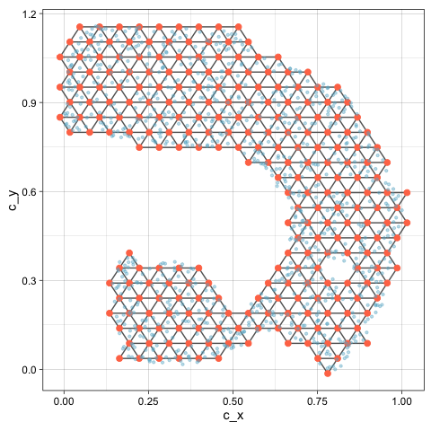
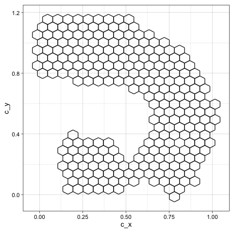

# Getting Started with quollr

## What does quollr do?

Nonlinear dimension reduction (NLDR) methods like UMAP and tSNE can
produce very different layouts of the same data depending on method and
hyper-parameter choices. Choosing poorly can lead to misleading
conclusions, such as spurious clusters or artificial separations between
groups. `quollr` helps you assess which layout most faithfully
represents the original high-dimensional structure. It does this by
fitting a wireframe model in 2-D and lifting it back into
high-dimensional space, where you can inspect it directly using a tour.
The result is both a visual diagnostic and a quantitative
goodness-of-fit metric (hexbin error, HBE).

## Your inputs

The package requires two data objects in a specific format.

``` r

library(quollr)

# High-dimensional data: must have an ID column and variables prefixed with x
head(scurve, 3)
#> # A tibble: 3 × 8
#>        x1    x2       x3      x4       x5      x6      x7    ID
#>     <dbl> <dbl>    <dbl>   <dbl>    <dbl>   <dbl>   <dbl> <int>
#> 1 -0.120  0.819 -1.99     0.0114  0.00351  0.0334 0.00638     1
#> 2 -0.0492 0.166  0.00121  0.0115 -0.0166  -0.0297 0.00509     2
#> 3 -0.774  0.651  0.367   -0.0172  0.00600  0.0211 0.00303     3

# 2-D NLDR embedding: must have ID, emb1, and emb2 columns
head(scurve_umap, 3)
#> # A tibble: 3 × 3
#>    emb1   emb2    ID
#>   <dbl>  <dbl> <int>
#> 1 -4.24  5.80      1
#> 2  3.19 -0.851     2
#> 3  4.65 -3.31      3
```

The `ID` column links the two datasets. High-dimensional variables must
be prefixed with `x` (e.g. `x1`, `x2`, …). The embedding columns must be
named `emb1` and `emb2`.

## Fit the model in one step

The main entry point is
[`fit_highd_model()`](https://jayanilakshika.github.io/quollr/reference/fit_highd_model.md),
which runs the complete pipeline — scaling, hexagonal binning, centroid
triangulation, and lifting into high dimensions — in a single call.

``` r

model <- fit_highd_model(
  highd_data = scurve,
  nldr_data  = scurve_umap,
  b1         = 21,
  q          = 0.1,
  hd_thresh  = 0
)
```

The returned object contains everything needed for visualisation and
diagnostics:

- `model$model_2d` — 2-D bin centroids
- `model$model_highd` — high-dimensional bin averages
- `model$trimesh_data` — triangular mesh edges
- `model$hb_obj` — hexagonal bin configurations
- `model$nldr_scaled_obj` — scaled embedding

For a step-by-step explanation of each stage, see
[`vignette("quollr2dataprocessing")`](https://jayanilakshika.github.io/quollr/articles/quollr2dataprocessing.md)
through
[`vignette("quollr3hexbin")`](https://jayanilakshika.github.io/quollr/articles/quollr3hexbin.md)
and
[`vignette("quollr4algo")`](https://jayanilakshika.github.io/quollr/articles/quollr4algo.md).

## Inspect the model in 2-D

The triangular mesh overlaid on the NLDR layout shows how the hexagonal
bins are connected. Gaps in the mesh indicate sparse regions in the
embedding.

``` r

library(ggplot2)

ggplot() +
  geom_trimesh(
    data = model$model_2d,
    aes(x = c_x, y = c_y)
  ) +
  geom_point(
    data = model$nldr_scaled_obj$scaled_nldr,
    aes(x = emb1, y = emb2),
    alpha = 0.4, size = 0.8, colour = "#66B2CC"
  ) +
  theme_linedraw() +
  theme(aspect.ratio = 1)
```



You can also visualise only the hexagonal bins that contain data using
[`geom_hexgrid()`](https://jayanilakshika.github.io/quollr/reference/geom_hexgrid.md):

``` r

ggplot() +
  geom_hexgrid(
    data = model$model_2d,
    aes(x = c_x, y = c_y)
  ) +
  theme_linedraw() +
  theme(aspect.ratio = 1)
```



## Lift into high dimensions

To inspect how well the 2-D layout preserves the high-dimensional
structure, combine the data and model, then view in a tour.

``` r

df <- comb_data_model(
  highd_data  = scurve,
  model_highd = model$model_highd,
  model_2d    = model$model_2d
)
```

``` r

# Interactive tour — run this in your R session
show_langevitour(
  point_data = df,
  edge_data  = model$trimesh_data
)
```

Rotating the tour reveals whether the wireframe traces the true shape of
the data in high dimensions. A well-fitted model will follow the data
cloud closely across many projection angles. For guidance on
interpreting the tour, see
[`vignette("quollr4algo")`](https://jayanilakshika.github.io/quollr/articles/quollr4algo.md).

## Evaluate the fit with HBE

HBE (hexbin error) summarises how well the 2-D layout preserves the
high-dimensional structure as a single number — the root mean squared
error between the original data and the lifted model.

``` r

glance(x = model, highd_data = scurve)
#> # A tibble: 1 × 2
#>   Error   HBE
#>   <dbl> <dbl>
#> 1  196. 0.116
```

For point-level diagnostics (residuals per observation), use
[`augment()`](https://jayanilakshika.github.io/quollr/reference/augment.md):

``` r

errors <- augment(x = model, highd_data = scurve)
head(errors[, c("ID", "row_wise_abs_error", "row_wise_total_error")], 5)
#> # A tibble: 5 × 3
#>      ID row_wise_abs_error row_wise_total_error
#>   <int>              <dbl>                <dbl>
#> 1     1             0.210               0.0147 
#> 2     2             0.0955              0.00246
#> 3     3             0.231               0.0128 
#> 4     4             0.206               0.0105 
#> 5     5             0.237               0.0142
```

Comparing HBE across methods and bin widths helps identify the layout
that most faithfully represents the data. See
[`vignette("quollr6bestbinwidth")`](https://jayanilakshika.github.io/quollr/articles/quollr6bestbinwidth.md)
for guidance on choosing the bin width, and
[`vignette("quollr7bestfit")`](https://jayanilakshika.github.io/quollr/articles/quollr7bestfit.md)
for a full comparison across NLDR methods.

## Linked interactive plots

For deeper diagnostics, `quollr` provides interactively linked plots
that connect the 2-D layout, the high-dimensional tour, and the residual
distribution. Brushing in any panel highlights the corresponding points
in all other panels.

``` r

# Prepare combined data including NLDR coordinates
df_all <- comb_all_data_model(
  highd_data  = scurve,
  nldr_data   = scurve_umap,
  model_highd = model$model_highd,
  model_2d    = model$model_2d
)

show_link_plots(
  point_data  = df_all,
  edge_data   = model$trimesh_data,
  point_colour = "#66B2CC"
)
```

## Where to go next

| Vignette | Topic |
|----|----|
| [`vignette("quollr2dataprocessing")`](https://jayanilakshika.github.io/quollr/articles/quollr2dataprocessing.md) | Data preprocessing and scaling |
| [`vignette("quollr3hexbin")`](https://jayanilakshika.github.io/quollr/articles/quollr3hexbin.md) | Hexagonal binning in detail |
| [`vignette("quollr4algo")`](https://jayanilakshika.github.io/quollr/articles/quollr4algo.md) | Full pipeline and tour interpretation |
| [`vignette("quollr5summary")`](https://jayanilakshika.github.io/quollr/articles/quollr5summary.md) | Model summaries and residuals |
| [`vignette("quollr6bestbinwidth")`](https://jayanilakshika.github.io/quollr/articles/quollr6bestbinwidth.md) | Choosing the optimal bin width |
| [`vignette("quollr7bestfit")`](https://jayanilakshika.github.io/quollr/articles/quollr7bestfit.md) | Comparing NLDR methods with HBE |
| [`vignette("quollr8linkeddetourr")`](https://jayanilakshika.github.io/quollr/articles/quollr8linkeddetourr.md) | Linked plots with `detourr` |
