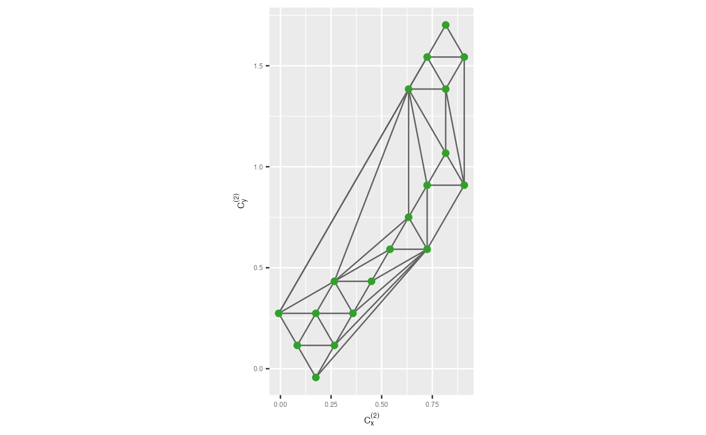
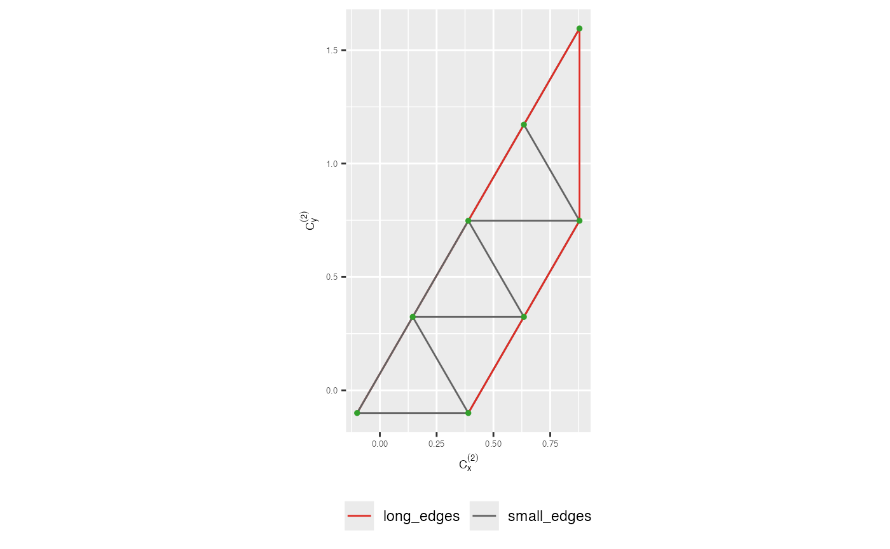
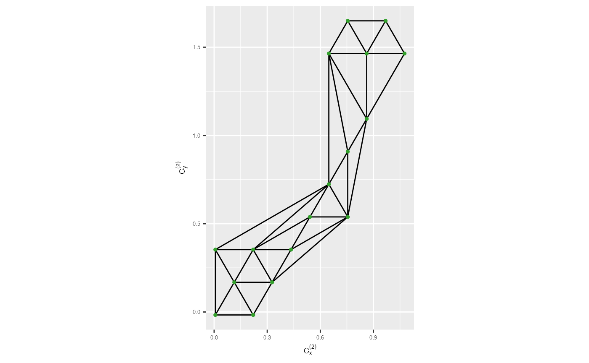

# 2. Algorithm for visualising the model overlaid on high-dimensional data

In here, we’ll walk through the algorithm for preprocessing 2D embedding
data to construct a model overlaid with high-dimensional data.

``` r

library(quollr)
library(ggplot2)
library(tibble)
library(dplyr)
library(stats)
```

The algorithm consists of two steps. First, construct the model in 2D
space. Second, lift the model into high-dimensions. Therefore, to begin
the process, first you need to know how the 2D model is constructed.

## Construct the 2D model

### Binning the data

To construct the model in the 2D space, first you need to hexagonally
bins the 2D layout. Discussed in details in [3. Algorithm for binning
data](https://quollr.netlify.app/articles/visfullgrid).

``` r

r2 <- diff(range(s_curve_noise_umap$UMAP2))/diff(range(s_curve_noise_umap$UMAP1))
hb_obj <- hex_binning(data = s_curve_noise_umap_scaled, bin1 = 6, r2 = r2)

all_centroids_df <- hb_obj$centroids
counts_df <- hb_obj$std_cts
```

### Obtain bin centroids

Nest step is to obtain the hexagonal bin centroid coordinates
(`all_centroids_df`) and standard number of points within each hexagon
(`counts_df`). Then, you can generate tibble which gives hexagonal ID,
centroid coordinates and standard counts where data exists.

``` r

df_bin_centroids <- extract_hexbin_centroids(centroids_df = all_centroids_df,
                                             counts_df = counts_df) |>
      filter(drop_empty == FALSE)

glimpse(df_bin_centroids) 
#> Rows: 24
#> Columns: 6
#> $ hexID      <int> 2, 7, 8, 9, 10, 14, 15, 16, 17, 18, 22, 23, 26, 27, 28, 29,…
#> $ c_x        <dbl> 0.117873476, 0.008936738, 0.226810215, 0.444683691, 0.66255…
#> $ c_y        <dbl> -0.09382762, 0.09485635, 0.09485635, 0.09485635, 0.09485635…
#> $ bin_counts <int> 49, 203, 288, 182, 198, 161, 90, 215, 216, 153, 36, 140, 15…
#> $ std_counts <dbl> 0.16896552, 0.70000000, 0.99310345, 0.62758621, 0.68275862,…
#> $ drop_empty <lgl> FALSE, FALSE, FALSE, FALSE, FALSE, FALSE, FALSE, FALSE, FAL…
```

### Remove low density hexagons

One of the parameters that you need to control is that the benchmark
value to remove low density hexagons. The default value is the first
quartile of the standardise counts.

``` r

benchmark_value_rm_lwd <- quantile(df_bin_centroids$std_counts, 
                probs = c(0,0.25,0.5,0.75,1), names = FALSE)[2]

benchmark_value_rm_lwd
#> [1] 0.275
```

There is two ways that you can follow after this. First, you can remove
the low density hexagons from `df_bin_centroids` and proceed. Second,
you can check whether is that actually reliable to remove the identified
low density hexagons by looking at their neighboring bins and if so
remove them and proceed. In here, let’s do with second option.

Here, you need to obtain the low density hexagons.

``` r

df_bin_centroids_low <- df_bin_centroids |>
  filter(std_counts <= benchmark_value_rm_lwd)

glimpse(df_bin_centroids_low)
#> Rows: 6
#> Columns: 6
#> $ hexID      <int> 2, 22, 35, 38, 39, 40
#> $ c_x        <dbl> 0.1178735, 0.6625572, 0.8804306, 0.1178735, 0.3357470, 0.55…
#> $ c_y        <dbl> -0.09382762, 0.47222428, 0.84959221, 1.03827617, 1.03827617…
#> $ bin_counts <int> 49, 36, 25, 21, 8, 21
#> $ std_counts <dbl> 0.16896552, 0.12413793, 0.08620690, 0.07241379, 0.02758621,…
#> $ drop_empty <lgl> FALSE, FALSE, FALSE, FALSE, FALSE, FALSE
```

Next, check the neighboring bins of low-density hexagons and decide
which should actually need to remove.

``` r

identify_rm_bins <- find_low_dens_hex(df_bin_centroids_all = df_bin_centroids, 
                                      bin1 = 6, 
                                      df_bin_centroids_low = df_bin_centroids_low)
identify_rm_bins
#> [1] 39
```

As you have seen, even though there are low density hexagons, it’s not a
good decision to remove them. Therefore, let’s use the same
`df_bin_centroids` as before.

### Triangulate bin centroids

Then, you need to triangulate the bin centroids.

``` r

tr1_object <- tri_bin_centroids(hex_df = df_bin_centroids, x = "c_x", y = "c_y")
str(tr1_object)
#> List of 11
#>  $ n     : int 24
#>  $ x     : num [1:24] 0.11787 0.00894 0.22681 0.44468 0.66256 ...
#>  $ y     : num [1:24] -0.0938 0.0949 0.0949 0.0949 0.0949 ...
#>  $ nt    : int 37
#>  $ trlist: int [1:37, 1:9] 1 6 7 4 4 8 5 5 13 13 ...
#>   ..- attr(*, "dimnames")=List of 2
#>   .. ..$ : NULL
#>   .. ..$ : chr [1:9] "i1" "i2" "i3" "j1" ...
#>  $ cclist: num [1:37, 1:5] 0.118 0.118 0.227 0.336 0.336 ...
#>   ..- attr(*, "dimnames")=List of 2
#>   .. ..$ : NULL
#>   .. ..$ : chr [1:5] "x" "y" "r" "area" ...
#>  $ nchull: int 9
#>  $ chull : int [1:9] 2 1 5 10 21 24 23 22 17
#>  $ narcs : int 60
#>  $ arcs  : int [1:60, 1:2] 3 2 1 3 6 3 7 3 4 1 ...
#>   ..- attr(*, "dimnames")=List of 2
#>   .. ..$ : NULL
#>   .. ..$ : chr [1:2] "from" "to"
#>  $ call  : language tri.mesh(x = hex_df[[rlang::as_string(rlang::sym(x))]], y = hex_df[[rlang::as_string(rlang::sym(y))]])
#>  - attr(*, "class")= chr "triSht"
```

To visualize the results, simply use
[`geom_trimesh()`](https://jayanilakshika.github.io/quollr/reference/geom_trimesh.md)
and provide the hexagonal bin centroid coordinates. This will display
the triangular mesh for you to examine.

``` r

trimesh <- ggplot(df_bin_centroids, aes(x = c_x, y = c_y)) +
  geom_trimesh() +
  coord_equal() +
  xlab(expression(C[x]^{(2)})) + ylab(expression(C[y]^{(2)})) +
  theme(axis.text = element_text(size = 5),
        axis.title = element_text(size = 7))

trimesh
```



### Create the wireframe in 2D

To build the wireframe in 2D, you’ll need to identify which vertices are
connected. You can obtain this by passing the triangular object to the
`gen_edges` function, which will provide information on the existing
edges and the connected vertices.

``` r

tr_from_to_df <- gen_edges(tri_object = tr1_object)
glimpse(tr_from_to_df)
#> Rows: 60
#> Columns: 6
#> $ from   <int> 1, 2, 6, 4, 3, 7, 5, 4, 2, 6, 7, 8, 8, 8, 2, 17, 13, 14, 11, 11…
#> $ to     <int> 3, 6, 7, 7, 4, 8, 8, 5, 13, 13, 14, 11, 9, 15, 17, 18, 18, 15, …
#> $ x_from <dbl> 0.117873476, 0.008936738, 0.117873476, 0.444683691, 0.226810215…
#> $ y_from <dbl> -0.09382762, 0.09485635, 0.28354031, 0.09485635, 0.09485635, 0.…
#> $ x_to   <dbl> 0.226810215, 0.117873476, 0.335746953, 0.335746953, 0.444683691…
#> $ y_to   <dbl> 0.09485635, 0.28354031, 0.28354031, 0.28354031, 0.09485635, 0.2…
```

### Remove long edges

Another important parameter in this algorithm is the benchmark value for
removing long edges. To compute this value, you first need to generate
the 2D Euclidean distance dataset for the edges.

``` r

distance_df <- cal_2d_dist(tr_coord_df = tr_from_to_df, start_x = "x_from", 
                           start_y = "y_from", end_x = "x_to", end_y = "y_to", 
                           select_vars = c("from", "to", "distance"))
glimpse(distance_df)
#> Rows: 60
#> Columns: 3
#> $ from     <int> 1, 2, 6, 4, 3, 7, 5, 4, 2, 6, 7, 8, 8, 8, 2, 17, 13, 14, 11, …
#> $ to       <int> 3, 6, 7, 7, 4, 8, 8, 5, 13, 13, 14, 11, 9, 15, 17, 18, 18, 15…
#> $ distance <dbl> 0.2178735, 0.2178735, 0.2178735, 0.2178735, 0.2178735, 0.2178…
```

Then, you can use the
[`find_lg_benchmark()`](https://jayanilakshika.github.io/quollr/reference/find_lg_benchmark.md)
function to compute a default benchmark value to remove long edges.
However, this default value may need adjustment for a better
representation. In here, used the benchmark value as $`0.75`$.

``` r

benchmark <- find_lg_benchmark(distance_edges = distance_df, 
                                  distance_col = "distance")
benchmark
#> [1] 0.377
```

To visualize the results, you can use
[`vis_lg_mesh()`](https://jayanilakshika.github.io/quollr/reference/vis_lg_mesh.md)
and
[`vis_rmlg_mesh()`](https://jayanilakshika.github.io/quollr/reference/vis_rmlg_mesh.md).
These functions enable you to observe the wireframe in 2D obtained from
the algorithm’s computations.

``` r

trimesh_coloured <- vis_lg_mesh(distance_edges = distance_df, 
                                     benchmark_value = 0.75, 
                                     tr_coord_df = tr_from_to_df, 
                                     distance_col = "distance") +
  xlab(expression(C[x]^{(2)})) + ylab(expression(C[y]^{(2)})) +
  theme(axis.text = element_text(size = 5),
        axis.title = element_text(size = 7),
        legend.position = "bottom",
        legend.title = element_blank())

trimesh_coloured
```



``` r


trimesh_removed <- vis_rmlg_mesh(distance_edges = distance_df, 
                                     benchmark_value = 0.75, 
                                     tr_coord_df = tr_from_to_df, 
                                     distance_col = "distance") +
  xlab(expression(C[x]^{(2)})) + ylab(expression(C[y]^{(2)})) +
  theme(axis.text = element_text(size = 5),
        axis.title = element_text(size = 7))

trimesh_removed
```



## Lift the model into high-dimensions

To lift the constructed model into high-dimensions, you need to map the
2D hexagonal bin centroids to high-dimensions. To do that, first, you
need to obtain the data set which have the 2D embedding with their
corresponding hexagonal bin IDs.

``` r

umap_data_with_hb_id <- hb_obj$data_hb_id
glimpse(umap_data_with_hb_id)
#> Rows: 3,750
#> Columns: 4
#> $ UMAP1 <dbl> 0.27573928, 0.92725180, 0.80951427, 0.13715412, 0.47647972, 0.04…
#> $ UMAP2 <dbl> 0.914623840, 0.347295951, 0.241819232, 0.656780486, 0.799175361,…
#> $ ID    <int> 1, 2, 3, 5, 6, 7, 9, 10, 11, 12, 15, 16, 18, 19, 24, 25, 26, 27,…
#> $ hb_id <int> 32, 18, 17, 26, 33, 7, 34, 17, 23, 14, 32, 2, 32, 29, 32, 18, 31…
```

Next, you need to create a data set with the high-dimensional data and
the 2D embedding with hexagonal bin IDs.

``` r

df_all <- dplyr::bind_cols(s_curve_noise_training |> dplyr::select(-ID), umap_data_with_hb_id)
glimpse(df_all)
#> Rows: 3,750
#> Columns: 11
#> $ x1    <dbl> -0.11970232, -0.04921160, -0.77446658, -0.47814517, 0.81769684, …
#> $ x2    <dbl> 1.6378934, 1.5091702, 1.3025775, 0.0176821, 0.9269894, 1.4012232…
#> $ x3    <dbl> -1.9928098283, 0.0012116250, 0.3673851752, -1.8782808189, -1.575…
#> $ x4    <dbl> 0.0104235802, -0.0177487701, -0.0017319658, 0.0084845242, -0.003…
#> $ x5    <dbl> 1.247143e-02, 7.263505e-03, 1.558974e-02, 5.331790e-03, -9.79905…
#> $ x6    <dbl> 0.092310860, -0.036199525, -0.096239517, 0.099753067, 0.09891648…
#> $ x7    <dbl> -0.0012762884, -0.0053483078, 0.0033535915, 0.0006769539, 0.0069…
#> $ UMAP1 <dbl> 0.27573928, 0.92725180, 0.80951427, 0.13715412, 0.47647972, 0.04…
#> $ UMAP2 <dbl> 0.914623840, 0.347295951, 0.241819232, 0.656780486, 0.799175361,…
#> $ ID    <int> 1, 2, 3, 5, 6, 7, 9, 10, 11, 12, 15, 16, 18, 19, 24, 25, 26, 27,…
#> $ hb_id <int> 32, 18, 17, 26, 33, 7, 34, 17, 23, 14, 32, 2, 32, 29, 32, 18, 31…
```

Then, use
[`avg_highd_data()`](https://jayanilakshika.github.io/quollr/reference/avg_highd_data.md)
to obtain the high-dimensional coordinates of the model.

``` r

df_bin <- avg_highd_data(data = df_all, col_start = "x")
glimpse(df_bin)
#> Rows: 24
#> Columns: 8
#> $ hb_id <int> 2, 7, 8, 9, 10, 14, 15, 16, 17, 18, 22, 23, 26, 27, 28, 29, 31, …
#> $ x1    <dbl> 0.60502895, 0.89506510, 0.15057032, -0.61992321, -0.96031558, 0.…
#> $ x2    <dbl> 1.7979353, 1.2803295, 1.2721767, 1.1659372, 1.5043088, 0.3120879…
#> $ x3    <dbl> 1.783629951, 1.379896396, 1.953298180, 1.757914643, 1.044983514,…
#> $ x4    <dbl> -3.639940e-03, -3.839172e-04, -7.412989e-04, -4.615018e-05, 6.22…
#> $ x5    <dbl> 2.986351e-04, -8.150889e-04, 1.088423e-03, 4.499042e-04, 5.26555…
#> $ x6    <dbl> -0.0104338345, -0.0018955210, 0.0011397559, -0.0004884167, 0.002…
#> $ x7    <dbl> 2.827596e-04, -9.927984e-05, 6.435293e-06, 3.529844e-04, 6.46460…
```

## Result

Finally, to visualise the model overlaid with the high-dimensional data,
you initially need to pass the data set with the high-dimensional data
and the 2D embedding with hexagonal bin IDs (`df_all`), high-dimensional
mapping of hexagonal bin centroids (`df_bin`), 2D hexagonal bin
coordinates (`df_bin_centroids`), and wireframe data (`distance_df`).

``` r

tour1 <- show_langevitour(df = df_all, df_b = df_bin, 
                          df_b_with_center_data = df_bin_centroids, 
                          benchmark_value = 0.75, 
                          distance_df = distance_df, distance_col = "distance", 
                          use_default_benchmark_val = FALSE, col_start = "x")

tour1
```
