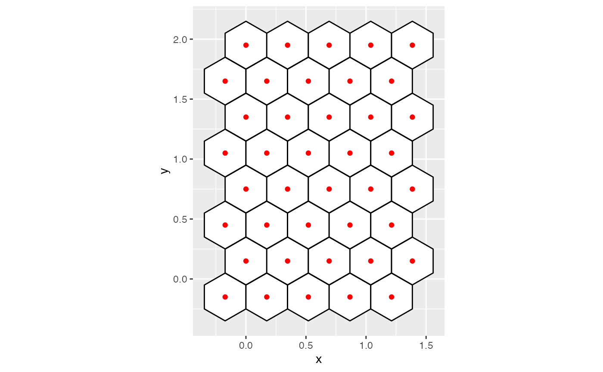
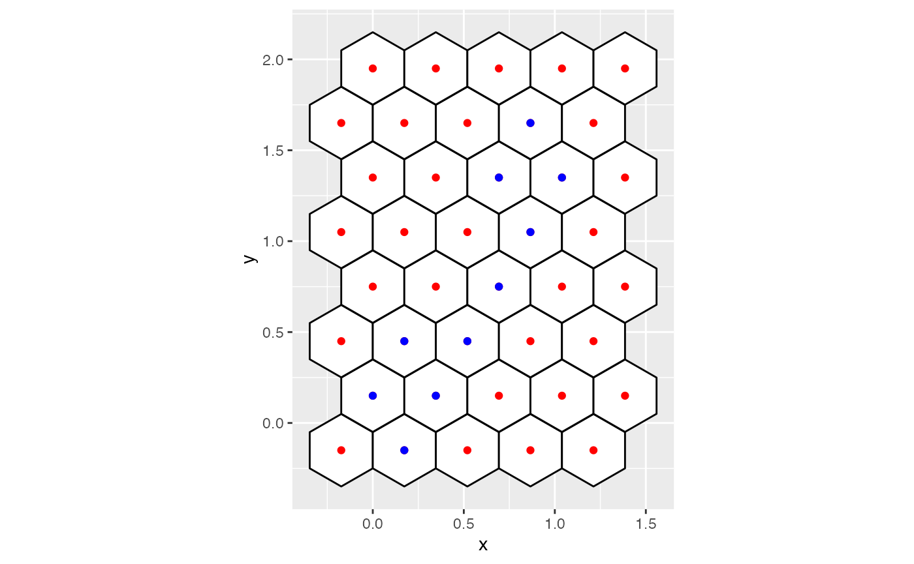
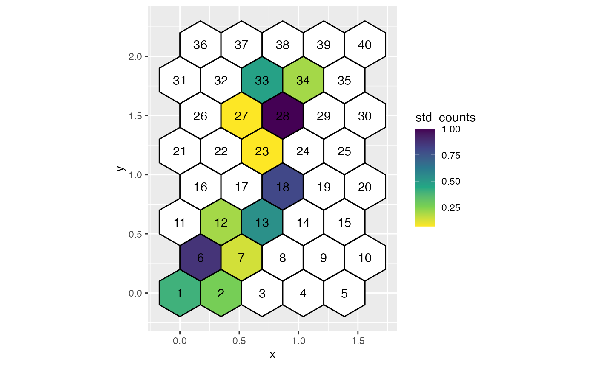
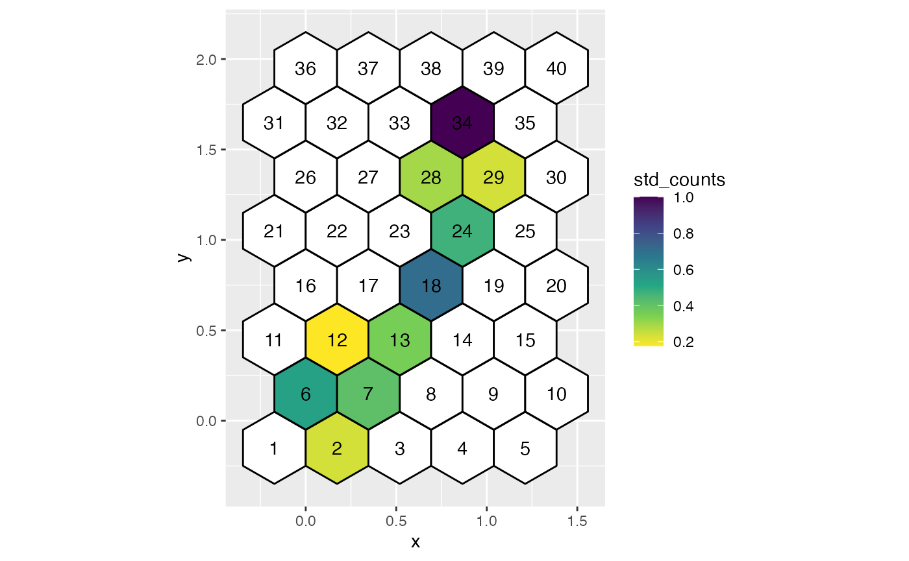

# 2. Visualise full hexagonal grid

``` r

## Data set with all possible centroids in the hexagonal grid
all_centroids_df <- as.data.frame(do.call(cbind, hb_obj$centroids))
all_centroids_df
#>    hexID        c_x   c_y
#> 1      1 -0.1732051 -0.15
#> 2      2  0.1732051 -0.15
#> 3      3  0.5196152 -0.15
#> 4      4  0.8660254 -0.15
#> 5      5  1.2124356 -0.15
#> 6      6  0.0000000  0.15
#> 7      7  0.3464102  0.15
#> 8      8  0.6928203  0.15
#> 9      9  1.0392305  0.15
#> 10    10  1.3856406  0.15
#> 11    11 -0.1732051  0.45
#> 12    12  0.1732051  0.45
#> 13    13  0.5196152  0.45
#> 14    14  0.8660254  0.45
#> 15    15  1.2124356  0.45
#> 16    16  0.0000000  0.75
#> 17    17  0.3464102  0.75
#> 18    18  0.6928203  0.75
#> 19    19  1.0392305  0.75
#> 20    20  1.3856406  0.75
#> 21    21 -0.1732051  1.05
#> 22    22  0.1732051  1.05
#> 23    23  0.5196152  1.05
#> 24    24  0.8660254  1.05
#> 25    25  1.2124356  1.05
#> 26    26  0.0000000  1.35
#> 27    27  0.3464102  1.35
#> 28    28  0.6928203  1.35
#> 29    29  1.0392305  1.35
#> 30    30  1.3856406  1.35
#> 31    31 -0.1732051  1.65
#> 32    32  0.1732051  1.65
#> 33    33  0.5196152  1.65
#> 34    34  0.8660254  1.65
#> 35    35  1.2124356  1.65
#> 36    36  0.0000000  1.95
#> 37    37  0.3464102  1.95
#> 38    38  0.6928203  1.95
#> 39    39  1.0392305  1.95
#> 40    40  1.3856406  1.95

## Generate all coordinates of hexagons
hex_grid <- as.data.frame(do.call(cbind, hb_obj$hex_poly))
hex_grid
#>     hex_poly_id          x           y
#> 1             1  0.0000000 -0.05040708
#> 2             1  0.0000000 -0.24959292
#> 3             1 -0.1732051 -0.34918584
#> 4             1 -0.3464102 -0.24959292
#> 5             1 -0.3464102 -0.05040708
#> 6             1 -0.1732051  0.04918584
#> 7             2  0.3464102 -0.05040708
#> 8             2  0.3464102 -0.24959292
#> 9             2  0.1732051 -0.34918584
#> 10            2  0.0000000 -0.24959292
#> 11            2  0.0000000 -0.05040708
#> 12            2  0.1732051  0.04918584
#> 13            3  0.6928203 -0.05040708
#> 14            3  0.6928203 -0.24959292
#> 15            3  0.5196152 -0.34918584
#> 16            3  0.3464102 -0.24959292
#> 17            3  0.3464102 -0.05040708
#> 18            3  0.5196152  0.04918584
#> 19            4  1.0392305 -0.05040708
#> 20            4  1.0392305 -0.24959292
#> 21            4  0.8660254 -0.34918584
#> 22            4  0.6928203 -0.24959292
#> 23            4  0.6928203 -0.05040708
#> 24            4  0.8660254  0.04918584
#> 25            5  1.3856406 -0.05040708
#> 26            5  1.3856406 -0.24959292
#> 27            5  1.2124356 -0.34918584
#> 28            5  1.0392305 -0.24959292
#> 29            5  1.0392305 -0.05040708
#> 30            5  1.2124356  0.04918584
#> 31            6  0.1732051  0.24959292
#> 32            6  0.1732051  0.05040708
#> 33            6  0.0000000 -0.04918584
#> 34            6 -0.1732051  0.05040708
#> 35            6 -0.1732051  0.24959292
#> 36            6  0.0000000  0.34918584
#> 37            7  0.5196152  0.24959292
#> 38            7  0.5196152  0.05040708
#> 39            7  0.3464102 -0.04918584
#> 40            7  0.1732051  0.05040708
#> 41            7  0.1732051  0.24959292
#> 42            7  0.3464102  0.34918584
#> 43            8  0.8660254  0.24959292
#> 44            8  0.8660254  0.05040708
#> 45            8  0.6928203 -0.04918584
#> 46            8  0.5196152  0.05040708
#> 47            8  0.5196152  0.24959292
#> 48            8  0.6928203  0.34918584
#> 49            9  1.2124356  0.24959292
#> 50            9  1.2124356  0.05040708
#> 51            9  1.0392305 -0.04918584
#> 52            9  0.8660254  0.05040708
#> 53            9  0.8660254  0.24959292
#> 54            9  1.0392305  0.34918584
#> 55           10  1.5588457  0.24959292
#> 56           10  1.5588457  0.05040708
#> 57           10  1.3856406 -0.04918584
#> 58           10  1.2124356  0.05040708
#> 59           10  1.2124356  0.24959292
#> 60           10  1.3856406  0.34918584
#> 61           11  0.0000000  0.54959292
#> 62           11  0.0000000  0.35040708
#> 63           11 -0.1732051  0.25081416
#> 64           11 -0.3464102  0.35040708
#> 65           11 -0.3464102  0.54959292
#> 66           11 -0.1732051  0.64918584
#> 67           12  0.3464102  0.54959292
#> 68           12  0.3464102  0.35040708
#> 69           12  0.1732051  0.25081416
#> 70           12  0.0000000  0.35040708
#> 71           12  0.0000000  0.54959292
#> 72           12  0.1732051  0.64918584
#> 73           13  0.6928203  0.54959292
#> 74           13  0.6928203  0.35040708
#> 75           13  0.5196152  0.25081416
#> 76           13  0.3464102  0.35040708
#> 77           13  0.3464102  0.54959292
#> 78           13  0.5196152  0.64918584
#> 79           14  1.0392305  0.54959292
#> 80           14  1.0392305  0.35040708
#> 81           14  0.8660254  0.25081416
#> 82           14  0.6928203  0.35040708
#> 83           14  0.6928203  0.54959292
#> 84           14  0.8660254  0.64918584
#> 85           15  1.3856406  0.54959292
#> 86           15  1.3856406  0.35040708
#> 87           15  1.2124356  0.25081416
#> 88           15  1.0392305  0.35040708
#> 89           15  1.0392305  0.54959292
#> 90           15  1.2124356  0.64918584
#> 91           16  0.1732051  0.84959292
#> 92           16  0.1732051  0.65040708
#> 93           16  0.0000000  0.55081416
#> 94           16 -0.1732051  0.65040708
#> 95           16 -0.1732051  0.84959292
#> 96           16  0.0000000  0.94918584
#> 97           17  0.5196152  0.84959292
#> 98           17  0.5196152  0.65040708
#> 99           17  0.3464102  0.55081416
#> 100          17  0.1732051  0.65040708
#> 101          17  0.1732051  0.84959292
#> 102          17  0.3464102  0.94918584
#> 103          18  0.8660254  0.84959292
#> 104          18  0.8660254  0.65040708
#> 105          18  0.6928203  0.55081416
#> 106          18  0.5196152  0.65040708
#> 107          18  0.5196152  0.84959292
#> 108          18  0.6928203  0.94918584
#> 109          19  1.2124356  0.84959292
#> 110          19  1.2124356  0.65040708
#> 111          19  1.0392305  0.55081416
#> 112          19  0.8660254  0.65040708
#> 113          19  0.8660254  0.84959292
#> 114          19  1.0392305  0.94918584
#> 115          20  1.5588457  0.84959292
#> 116          20  1.5588457  0.65040708
#> 117          20  1.3856406  0.55081416
#> 118          20  1.2124356  0.65040708
#> 119          20  1.2124356  0.84959292
#> 120          20  1.3856406  0.94918584
#> 121          21  0.0000000  1.14959292
#> 122          21  0.0000000  0.95040708
#> 123          21 -0.1732051  0.85081416
#> 124          21 -0.3464102  0.95040708
#> 125          21 -0.3464102  1.14959292
#> 126          21 -0.1732051  1.24918584
#> 127          22  0.3464102  1.14959292
#> 128          22  0.3464102  0.95040708
#> 129          22  0.1732051  0.85081416
#> 130          22  0.0000000  0.95040708
#> 131          22  0.0000000  1.14959292
#> 132          22  0.1732051  1.24918584
#> 133          23  0.6928203  1.14959292
#> 134          23  0.6928203  0.95040708
#> 135          23  0.5196152  0.85081416
#> 136          23  0.3464102  0.95040708
#> 137          23  0.3464102  1.14959292
#> 138          23  0.5196152  1.24918584
#> 139          24  1.0392305  1.14959292
#> 140          24  1.0392305  0.95040708
#> 141          24  0.8660254  0.85081416
#> 142          24  0.6928203  0.95040708
#> 143          24  0.6928203  1.14959292
#> 144          24  0.8660254  1.24918584
#> 145          25  1.3856406  1.14959292
#> 146          25  1.3856406  0.95040708
#> 147          25  1.2124356  0.85081416
#> 148          25  1.0392305  0.95040708
#> 149          25  1.0392305  1.14959292
#> 150          25  1.2124356  1.24918584
#> 151          26  0.1732051  1.44959292
#> 152          26  0.1732051  1.25040708
#> 153          26  0.0000000  1.15081416
#> 154          26 -0.1732051  1.25040708
#> 155          26 -0.1732051  1.44959292
#> 156          26  0.0000000  1.54918584
#> 157          27  0.5196152  1.44959292
#> 158          27  0.5196152  1.25040708
#> 159          27  0.3464102  1.15081416
#> 160          27  0.1732051  1.25040708
#> 161          27  0.1732051  1.44959292
#> 162          27  0.3464102  1.54918584
#> 163          28  0.8660254  1.44959292
#> 164          28  0.8660254  1.25040708
#> 165          28  0.6928203  1.15081416
#> 166          28  0.5196152  1.25040708
#> 167          28  0.5196152  1.44959292
#> 168          28  0.6928203  1.54918584
#> 169          29  1.2124356  1.44959292
#> 170          29  1.2124356  1.25040708
#> 171          29  1.0392305  1.15081416
#> 172          29  0.8660254  1.25040708
#> 173          29  0.8660254  1.44959292
#> 174          29  1.0392305  1.54918584
#> 175          30  1.5588457  1.44959292
#> 176          30  1.5588457  1.25040708
#> 177          30  1.3856406  1.15081416
#> 178          30  1.2124356  1.25040708
#> 179          30  1.2124356  1.44959292
#> 180          30  1.3856406  1.54918584
#> 181          31  0.0000000  1.74959292
#> 182          31  0.0000000  1.55040708
#> 183          31 -0.1732051  1.45081416
#> 184          31 -0.3464102  1.55040708
#> 185          31 -0.3464102  1.74959292
#> 186          31 -0.1732051  1.84918584
#> 187          32  0.3464102  1.74959292
#> 188          32  0.3464102  1.55040708
#> 189          32  0.1732051  1.45081416
#> 190          32  0.0000000  1.55040708
#> 191          32  0.0000000  1.74959292
#> 192          32  0.1732051  1.84918584
#> 193          33  0.6928203  1.74959292
#> 194          33  0.6928203  1.55040708
#> 195          33  0.5196152  1.45081416
#> 196          33  0.3464102  1.55040708
#> 197          33  0.3464102  1.74959292
#> 198          33  0.5196152  1.84918584
#> 199          34  1.0392305  1.74959292
#> 200          34  1.0392305  1.55040708
#> 201          34  0.8660254  1.45081416
#> 202          34  0.6928203  1.55040708
#> 203          34  0.6928203  1.74959292
#> 204          34  0.8660254  1.84918584
#> 205          35  1.3856406  1.74959292
#> 206          35  1.3856406  1.55040708
#> 207          35  1.2124356  1.45081416
#> 208          35  1.0392305  1.55040708
#> 209          35  1.0392305  1.74959292
#> 210          35  1.2124356  1.84918584
#> 211          36  0.1732051  2.04959292
#> 212          36  0.1732051  1.85040708
#> 213          36  0.0000000  1.75081416
#> 214          36 -0.1732051  1.85040708
#> 215          36 -0.1732051  2.04959292
#> 216          36  0.0000000  2.14918584
#> 217          37  0.5196152  2.04959292
#> 218          37  0.5196152  1.85040708
#> 219          37  0.3464102  1.75081416
#> 220          37  0.1732051  1.85040708
#> 221          37  0.1732051  2.04959292
#> 222          37  0.3464102  2.14918584
#> 223          38  0.8660254  2.04959292
#> 224          38  0.8660254  1.85040708
#> 225          38  0.6928203  1.75081416
#> 226          38  0.5196152  1.85040708
#> 227          38  0.5196152  2.04959292
#> 228          38  0.6928203  2.14918584
#> 229          39  1.2124356  2.04959292
#> 230          39  1.2124356  1.85040708
#> 231          39  1.0392305  1.75081416
#> 232          39  0.8660254  1.85040708
#> 233          39  0.8660254  2.04959292
#> 234          39  1.0392305  2.14918584
#> 235          40  1.5588457  2.04959292
#> 236          40  1.5588457  1.85040708
#> 237          40  1.3856406  1.75081416
#> 238          40  1.2124356  1.85040708
#> 239          40  1.2124356  2.04959292
#> 240          40  1.3856406  2.14918584

## To obtain the standardise counts within hexbins
counts_df <- as.data.frame(do.call(cbind, hb_obj$std_cts))
df_bin_centroids <- extract_hexbin_centroids(centroids_df = all_centroids_df, 
                                             counts_df = counts_df)

ggplot(data = hex_grid, aes(x = x, y = y)) + 
  geom_polygon(fill = "white", color = "black", aes(group = hex_poly_id)) +
  geom_point(data = all_centroids_df, aes(x = c_x, y = c_y), color = "red") +
  coord_fixed()
```



``` r


ggplot(data = hex_grid, aes(x = x, y = y)) + 
  geom_polygon(fill = "white", color = "black", aes(group = hex_poly_id)) +
  geom_point(data = all_centroids_df, aes(x = c_x, y = c_y), color = "red") +
  geom_point(data = df_bin_centroids, aes(x = c_x, y = c_y), color = "blue") +
  coord_fixed()
```



``` r


ggplot(data = hex_grid, aes(x = x, y = y)) + 
  geom_polygon(fill = "white", color = "black", aes(group = hex_poly_id)) +
  geom_point(data = s_curve_noise_umap_scaled, aes(x = UMAP1, y = UMAP2), color = "blue") +
  coord_fixed()
```



``` r


hex_grid_with_counts <- dplyr::left_join(hex_grid, counts_df, by = c("hex_poly_id" = "hb_id"))

ggplot(data = hex_grid_with_counts, aes(x = x, y = y)) +
  geom_polygon(color = "black", aes(group = hex_poly_id, fill = std_counts)) +
  geom_text(data = all_centroids_df, aes(x = c_x, y = c_y, label = hexID)) +
  scale_fill_viridis_c(direction = -1, na.value = "#ffffff") +
  coord_fixed()
```


