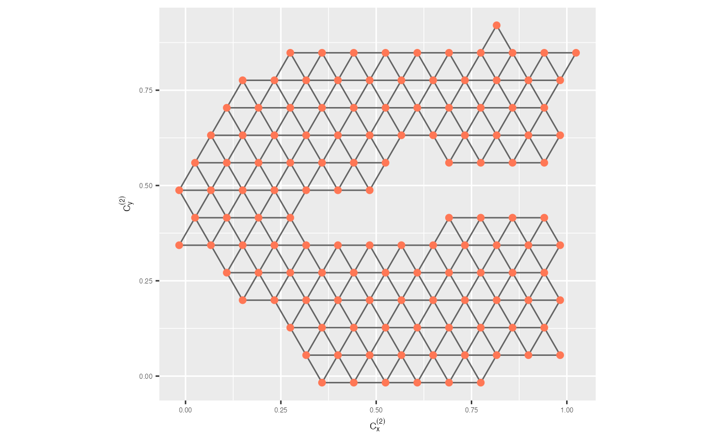

# 3. Algorithm for visualising the model overlaid on high-dimensional data

This walks through the algorithm for constructing a model from 2-D
embedding data and visualising it alongside high-dimensional data. The
process involves two major steps:

1.  **Constructing the model in the 2-D embedding space** using
    hexagonal binning and triangulation.
2.  **Lifting the model into high dimensions** to link it back to the
    original data space.

``` r

library(quollr)
library(ggplot2)
library(tibble)
library(dplyr)
library(stats)
```

## Step 1: Construct the 2-D model

### Hexagonal Binning

To begin, we preprocess the 2-D embedding and create hexagonal bins over
the layout.

``` r

## To pre-process the data
nldr_obj <- gen_scaled_data(nldr_data = scurve_umap)

## Obtain the hexbin object
hb_obj <- hex_binning(nldr_obj = nldr_obj, b1 = 15, q = 0.1)

all_centroids_df <- hb_obj$centroids
counts_df <- hb_obj$std_cts
```

### Extract bin centroids

Next, we extract the centroid coordinates and standardised bin counts.
These will be used to identify densely populated regions in the 2-D
space.

``` r

## To extract all bin centroids with bin counts
df_bin_centroids <- extract_hexbin_centroids(centroids_data = all_centroids_df,
                                             counts_data = counts_df)

benchmark_highdens <- 5

## To extract high-densed bins
model_2d <- df_bin_centroids |>
  dplyr::filter(n_h > benchmark_highdens)

glimpse(model_2d) 
#> Rows: 130
#> Columns: 5
#> $ h   <int> 21, 22, 23, 24, 25, 26, 36, 37, 38, 39, 40, 41, 42, 43, 44, 50, 51…
#> $ c_x <dbl> 0.3579375, 0.4411988, 0.5244602, 0.6077215, 0.6909829, 0.7742443, …
#> $ c_y <dbl> -0.01712962, -0.01712962, -0.01712962, -0.01712962, -0.01712962, -…
#> $ n_h <dbl> 12, 17, 22, 10, 7, 12, 42, 42, 44, 39, 52, 38, 52, 36, 27, 65, 47,…
#> $ w_h <dbl> 0.0024, 0.0034, 0.0044, 0.0020, 0.0014, 0.0024, 0.0084, 0.0084, 0.…
```

### Triangulate the bin centroids

We then triangulate the hexagon centroids to build a wireframe of
neighborhood relationships.

``` r

## Wireframe
tr_object <- tri_bin_centroids(centroids_data = df_bin_centroids)
str(tr_object)
#> List of 2
#>  $ trimesh_object:List of 11
#>   ..$ n     : int 240
#>   ..$ x     : num [1:240] -0.1 -0.0167 0.0665 0.1498 0.233 ...
#>   ..$ y     : num [1:240] -0.0892 -0.0892 -0.0892 -0.0892 -0.0892 ...
#>   ..$ nt    : int 431
#>   ..$ trlist: int [1:431, 1:9] 1 17 31 16 16 3 17 18 17 46 ...
#>   .. ..- attr(*, "dimnames")=List of 2
#>   .. .. ..$ : NULL
#>   .. .. ..$ : chr [1:9] "i1" "i2" "i3" "j1" ...
#>   ..$ cclist: num [1:431, 1:5] -0.0584 -0.0167 -0.1416 -0.0584 -0.0167 ...
#>   .. ..- attr(*, "dimnames")=List of 2
#>   .. .. ..$ : NULL
#>   .. .. ..$ : chr [1:5] "x" "y" "r" "area" ...
#>   ..$ nchull: int 47
#>   ..$ chull : int [1:47] 1 2 3 4 5 6 7 8 38 52 ...
#>   ..$ narcs : int 670
#>   ..$ arcs  : int [1:670, 1:2] 2 16 1 2 17 16 31 32 16 17 ...
#>   .. ..- attr(*, "dimnames")=List of 2
#>   .. .. ..$ : NULL
#>   .. .. ..$ : chr [1:2] "from" "to"
#>   ..$ call  : language tri.mesh(x = centroids_data[["c_x"]], y = centroids_data[["c_y"]])
#>   ..- attr(*, "class")= chr "triSht"
#>  $ n_h           : num [1:240] 0 0 0 0 0 0 0 0 0 0 ...
```

### Generate edges from triangulation

Using the triangulation object, we generate edges between centroids. We
retain only edges connecting densely populated bins.

``` r

trimesh_data <- gen_edges(tri_object = tr_object, a1 = hb_obj$a1) |>
  dplyr::filter(from_count > benchmark_highdens,
                to_count > benchmark_highdens)

## Update the edge indexes to start from 1
trimesh_data <- update_trimesh_index(trimesh_data)
glimpse(trimesh_data)
#> Rows: 322
#> Columns: 8
#> $ from       <int> 16, 25, 25, 36, 36, 1, 48, 37, 26, 27, 7, 16, 8, 1, 27, 7, …
#> $ to         <int> 26, 26, 37, 49, 37, 7, 49, 38, 27, 38, 16, 17, 17, 2, 28, 8…
#> $ x_from     <dbl> 0.27467611, 0.14978407, 0.14978407, 0.10815339, 0.10815339,…
#> $ y_from     <dbl> 0.12708328, 0.19918973, 0.19918973, 0.27129618, 0.27129618,…
#> $ x_to       <dbl> 0.23304543, 0.23304543, 0.19141475, 0.14978407, 0.19141475,…
#> $ y_to       <dbl> 0.19918973, 0.19918973, 0.27129618, 0.34340263, 0.27129618,…
#> $ from_count <dbl> 65, 39, 39, 62, 62, 12, 45, 62, 67, 56, 42, 65, 42, 12, 56,…
#> $ to_count   <dbl> 67, 67, 62, 34, 62, 42, 34, 68, 56, 68, 65, 47, 47, 17, 38,…
```

### Visualise the triangular mesh

``` r

trimesh <- ggplot(model_2d, aes(x = c_x, y = c_y)) +
  geom_trimesh() +
  coord_equal() +
  xlab(expression(C[x]^{(2)})) + ylab(expression(C[y]^{(2)})) +
  theme(axis.text = element_text(size = 5),
        axis.title = element_text(size = 7))

trimesh
```



## Step 2: Lift the model into high dimensions

### Map bins to high-dimensional observations

We begin by extracting the original data with their assigned hexagonal
bin IDs.

``` r

nldr_df_with_hex_id <- hb_obj$data_hb_id
glimpse(nldr_df_with_hex_id)
#> Rows: 5,000
#> Columns: 4
#> $ emb1 <dbl> 0.7066472, 0.2310437, 0.2317572, 0.7897575, 0.7612658, 0.4445289,…
#> $ emb2 <dbl> 0.83877384, 0.40078460, 0.21512301, 0.56425294, 0.55071856, 0.720…
#> $ ID   <int> 1, 2, 3, 4, 5, 6, 7, 8, 9, 10, 11, 12, 13, 14, 15, 16, 17, 18, 19…
#> $ h    <int> 205, 109, 65, 146, 146, 172, 58, 110, 141, 80, 109, 102, 72, 169,…
```

### Compute high-dimensional coordinates for bins

We calculate the average high-dimensional coordinates for each bin and
retain only the ones matching the 2-D model bins.

``` r

model_highd <- avg_highd_data(highd_data = scurve, scaled_nldr_hexid = nldr_df_with_hex_id)

model_highd <- model_highd |>
  dplyr::filter(h %in% model_2d$h)

glimpse(model_highd)
#> Rows: 130
#> Columns: 8
#> $ h  <int> 21, 22, 23, 24, 25, 26, 36, 37, 38, 39, 40, 41, 42, 43, 44, 50, 51,…
#> $ x1 <dbl> -0.99177515, -0.90610823, -0.68039636, -0.27233690, 0.07595360, 0.4…
#> $ x2 <dbl> 1.9144578, 1.9297375, 1.9327118, 1.9301472, 1.9285235, 1.9308755, 1…
#> $ x3 <dbl> 1.1144758, 1.4122003, 1.7247636, 1.9585367, 1.9953411, 1.8851445, 0…
#> $ x4 <dbl> -4.274718e-04, -1.828833e-05, -8.098659e-04, 2.512547e-03, 8.763913…
#> $ x5 <dbl> 0.0006244810, 0.0033144792, -0.0025895767, 0.0066812678, 0.00446645…
#> $ x6 <dbl> 0.007488568, -0.020430827, -0.004485358, -0.045987489, 0.008507020,…
#> $ x7 <dbl> 1.051068e-03, -3.631264e-04, 1.532865e-03, 1.275372e-03, -1.946201e…
```

## Step 3: Visualise the high-dimensional model

We now combine all components—high-dimensional data, the 2-D model,
lifted high-dimensional centroids, and the triangulation—and render the
model using an interactive tour.

### Prepare data for visualisation

``` r

df_exe <- comb_data_model(highd_data = scurve, 
                          model_highd = model_highd, 
                          model_2d = model_2d)
```

### Interactive tour of model overlay

``` r

tour1 <- show_langevitour(point_data = df_exe, edge_data = trimesh_data)

tour1
```
