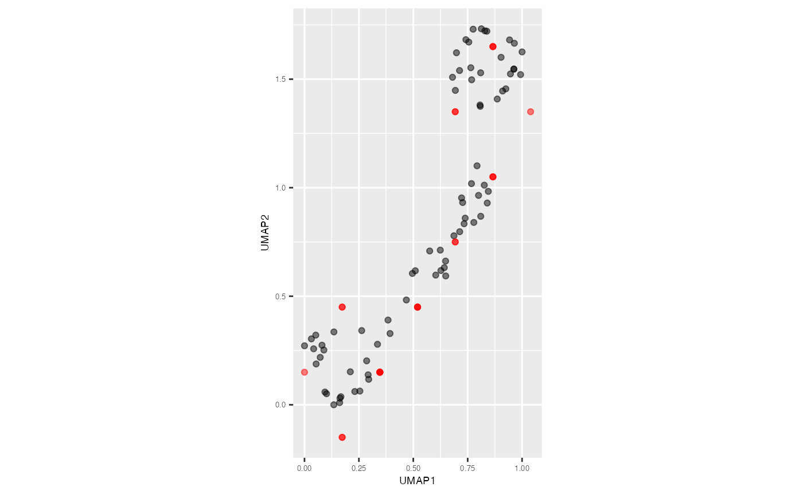

# 3. Predict 2D embeddings

Some Non-linear dimension reduction techniques (NLDR), such as
t-distributed stochastic neighbor embedding (tSNE) do not provide
mechanism to employ prediction like Uniform manifold approximation and
projection (UMAP). In that case, the `predict_2d_embeddings` function
serves as a valuable tool to predict 2D embeddings, regardless of the
NLDR technique.

``` r

model <- fit_highd_model(training_data = s_curve_noise_training, x = "UMAP1", 
                         y = "UMAP2", nldr_df_with_id = s_curve_noise_umap_scaled, 
                         col_start_2d = "UMAP", col_start_highd = "x")
df_bin_centroids <- model$df_bin_centroids
df_bin <- model$df_bin
```

``` r

predict_emb_list <- predict_emb(test_data = s_curve_noise_test, 
                                    df_bin_centroids = df_bin_centroids, 
                                    df_bin = df_bin, type_NLDR = "UMAP")

predict_df <- as.data.frame(do.call(cbind, predict_emb_list))
predict_df
#>    pred_UMAP_1 pred_UMAP_2 ID pred_hb_id
#> 1    0.1732051       -0.15  5          2
#> 2    0.8660254        1.05 10         24
#> 3    0.8660254        1.65 13         34
#> 4    0.3464102        0.15 18          7
#> 5    0.3464102        0.15 27          7
#> 6    0.3464102        0.15 28          7
#> 7    0.8660254        1.05 29         24
#> 8    0.8660254        1.65 30         34
#> 9    0.1732051       -0.15 32          2
#> 10   0.5196152        0.45 36         13
#> 11   0.3464102        0.15 48          7
#> 12   0.5196152        0.45 49         13
#> 13   0.6928203        0.75 50         18
#> 14   1.0392305        1.35 53         29
#> 15   0.5196152        0.45 58         13
#> 16   0.5196152        0.45 61         13
#> 17   0.0000000        0.15 68          6
#> 18   0.6928203        1.35 82         28
#> 19   0.1732051        0.45 83         12
#> 20   0.3464102        0.15 85          7
#> 21   0.6928203        0.75 86         18
#> 22   0.8660254        1.05 88         24
#> 23   0.1732051        0.45 90         12
#> 24   0.8660254        1.65 92         34
#> 25   0.6928203        1.35 98         28
```

``` r

s_curve_noise_umap_scaled |>
    ggplot(aes(x = UMAP1,
               y = UMAP2,
               label = ID))+
    geom_point(alpha=0.5) +
    geom_point(data = predict_df, aes(x = pred_UMAP_1, y = pred_UMAP_2), 
               color = "red", alpha=0.5) +
    coord_equal() +
    theme(plot.title = element_text(hjust = 0.5, size = 18, face = "bold"),
          axis.text = element_text(size = 5),
          axis.title = element_text(size = 7))
```


